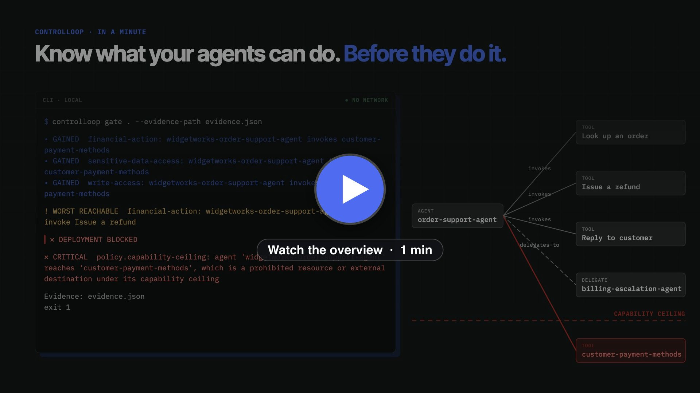
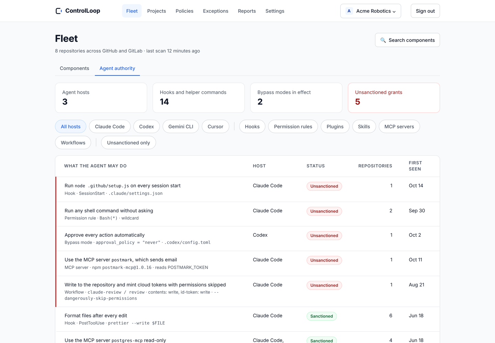
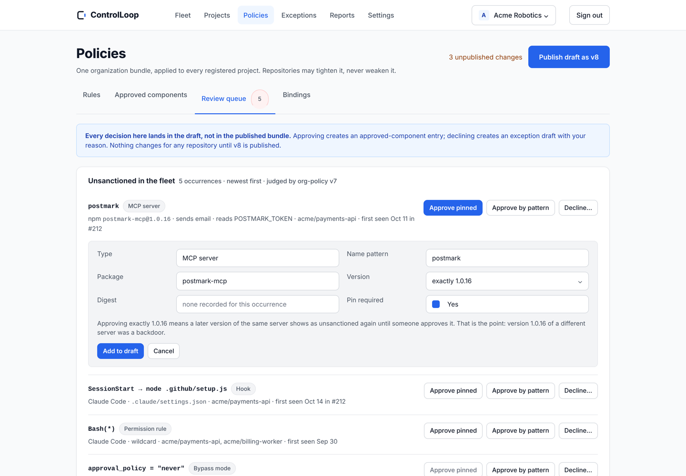

[](https://github.com/controlloop-security/controlloop/actions/workflows/ci.yml)
[](LICENSE)
[](#requirements)
[](docs/readme.md)
[](https://discord.gg/Ef4VuTvUFn)

> *Know what your agents can do. Before they do it.*

ControlLoop is a local-first scanner and deterministic CI gate for what your
AI agents can actually do. It reads the files that define an agent, builds
one graph of its capabilities, compares it to the state you approved, and
fails the build when the agent's authority grows past the ceiling you
declared. It never runs your code and never sends your source anywhere.

[](https://controlloop.ai/#video)

Watch: [the gate in a minute](https://controlloop.ai/#video) · Read: [the example walkthrough](docs/guides/example-walkthrough.md)

# ControlLoop CLI

An agent's real authority is spread across an agent card, an MCP config, an
OpenAPI spec, an IAM policy, and, for most agents, the framework code itself:
a CrewAI crew, a LangGraph graph, an OpenAI Agents SDK handoff chain. The same
goes for the coding agents that work on your repository. Claude Code, Codex,
Gemini CLI, Cursor, Kiro, Roo Code, and Cline are configured by committed
files, and so are the workflows that run an agent in CI. No single file tells
you that one pull request just gave an agent the ability to move money, or to
run a script on every session start.

> **How it works.** ControlLoop walks the repository and reads only committed
> files. Adapters turn them into an **Agent Capability Bill of Materials**
> (ACBOM): agents, tools, resources, identities, and permissions, with
> evidence for every node and edge. The graph is **diffed** against the
> baseline you approved, **classified** by a material capability taxonomy,
> judged by **18 policy rules** and the **capability ceiling** you declared,
> and the verdict is written to an **evidence artifact**. No model decides
> anything; the same inputs always produce the same verdict. Secrets,
> prompts, environment values, and file contents never reach the output.

> **Development preview.** `init`, `bom`, `diff`, `scan`, `gate`, `rules`,
> and `example` work and are covered by tests. There is no published release
> yet: no PyPI package, Homebrew tap, container image, or tagged version.
> Install from source as below.

## Features

### What it reads

- 🗂️ **A2A agent cards**, **MCP server declarations** for eleven agent hosts, **OpenAPI** documents, and **AWS IAM** policies in JSON or Terraform. See [the adapter table](docs/adapters/readme.md).
- 🧩 **Framework code**, parsed and never imported: [CrewAI](docs/adapters/readme.md), [LangGraph](docs/adapters/readme.md), and the [OpenAI Agents SDK](docs/adapters/readme.md). A tool it cannot resolve is reported as the worst reachable capability, never dropped.
- 🤖 **Coding agents' own configuration**: [Claude Code](docs/adapters/claude-code.md) settings, hooks, skills, subagents, plugins and marketplaces; [Codex](docs/adapters/codex.md); [Gemini CLI](docs/adapters/gemini-cli.md); [Cursor](docs/adapters/cursor.md); [Kiro](docs/adapters/kiro.md); [Roo Code](docs/adapters/roo.md) and [Cline](docs/adapters/cline.md) through their MCP configuration; and the [GitHub workflows that run an agent](docs/adapters/agent-workflows.md).

### What it tells you

- 🎯 **The blast radius, first.** Every report opens with the single worst thing the agent can do right now: `! WORST REACHABLE  financial-action: … can invoke Issue a refund`. [Material capability taxonomy](docs/reference/material-capability-taxonomy.md).
- 🗣️ **A plain-language authority statement** for every change to an agent's configuration: *This change gives Claude Code the power to run `node .github/setup.js` on every session start.* [Authority statement](docs/reference/authority-statement.md).
- 🔀 **A capability diff**, not a file diff: what became newly reachable against the baseline you approved, by class. [Capability diff](docs/reference/cli.md#diff).
- 📏 **A capability ceiling** that blocks authority nobody anticipated, through routes no rule matches, and cannot be suppressed. [Capability ceiling](docs/reference/capability-ceiling.md).
- 📚 **18 policy rules** with a plain message, a remediation, and a stable documentation link on every finding. [Policy rules](docs/reference/policy-rules.md).
- 🧾 **An evidence artifact** on every gate run, including the failing ones, plus JSON and SARIF 2.1.0 output. [Evidence artifact format](docs/reference/evidence-artifact-format.md).

### How it behaves

- 🔒 **Local and offline.** Core scanning works with the network disabled. Nothing is executed: no MCP server is started, no endpoint is contacted. [Privacy, security, and limitations](docs/reference/privacy-security.md).
- 🧮 **Deterministic.** Same inputs, same pinned versions, same digest, same verdict. Unknown is ranked worse than known, never safer.
- 🙈 **Nothing protected leaves.** Source, prompts, credentials, environment values, and customer data never appear in output, logs, errors, identity material, or artifacts.
- ⚙️ **CI-native.** A [GitHub Action](docs/reference/github-action.md) and a [pre-commit hook](docs/reference/pre-commit-hook.md) run the same gate.

> **Note:** the agent hosts whose project configuration is read are Claude
> Code, Codex, Gemini CLI, Cursor, and Kiro, each pinned to its
> documentation as read on a stated date (`controlloop --version` prints
> it). MCP declarations are also read from VS Code, Roo Code, Cline,
> Continue, Windsurf, and opencode.

## Quick start

### Installation

There is no package yet. Clone the repository and run from source:

```bash
git clone https://github.com/controlloop-security/controlloop
cd controlloop
uv sync --locked --all-groups
uv run controlloop --version
```

```text
ControlLoop 0.1.0
Supported OASF versions: none yet
Agent host key sets (documentation read on): claude-code 2026-10-17, codex 2026-10-17, cursor 2026-10-17, gemini-cli 2026-10-17, kiro 2026-10-17
Rule pack: controlloop-community 0.5.0 (18 rules)
```

### Requirements

- **Python 3.12**
- [**uv**](https://docs.astral.sh/uv/)
- **Git**, for the automatic merge-base baseline that `diff` and `gate` use
- macOS or Linux. Windows is unsupported.

### First run

Point it at a repository containing an agent:

```bash
uv run controlloop scan /path/to/your/agent-repo
```

Nothing to try it on? The public
[reference agent](https://github.com/controlloop-security/controlloop-reference-agent)
is a realistic, deliberately imperfect agent built for exactly this:

```bash
git clone https://github.com/controlloop-security/controlloop-reference-agent
uv run controlloop scan controlloop-reference-agent/scenarios/order-support-agent
```

```text
! WORST REACHABLE  financial-action: widgetworks-order-support-agent can invoke
  Issue a refund

✓ PASSED

• material change: not evaluated

! MEDIUM   policy.undeclared-tools: Tool 'Look up an order' is reachable but not
  declared in controlloop.yaml.
    at agent-card.json

! MEDIUM   policy.undeclared-tools: Tool 'Reply to customer' is reachable but
  not declared in controlloop.yaml.
    at agent-card.json

! MEDIUM   policy.undeclared-tools: Tool 'Issue a refund' is reachable but not
  declared in controlloop.yaml.
    at agent-card.json

Suppressions: none declared
```

Exit code `0`. New here? `uv run controlloop example` prints a six-step
walkthrough that matches the [example walkthrough](docs/guides/example-walkthrough.md) guide.

### The commands

| Command | Use it to |
| --- | --- |
| `scan` | Full report for a human: blast radius, verdict, changes, findings |
| `gate` | The same analysis for CI: one verdict, one exit code, an evidence artifact every time |
| `diff` | See what changed against a baseline, as capabilities rather than files |
| `bom` | Generate or validate the capability graph (ACBOM), natively or as CycloneDX |
| `init` | Draft a `controlloop.yaml` from what is actually in the repository |
| `rules` | List the rule pack in use and what each rule looks for |
| `example` | Print a guided walkthrough |

`scan` is what you run at your desk. `gate` is what you run in CI. Every
command and flag is in the [CLI reference](docs/reference/cli.md).

## Screenshots

Every block in this README is real output, recorded against the public
reference agent with the version above. Nothing is staged.

**A pull request adds a tool the agent's ceiling prohibits.** The blast radius
got worse, the ceiling breach blocks, and the evidence artifact is written:

```text
! WORST REACHABLE  financial-action: widgetworks-order-support-agent can invoke
  Issue a refund

✕ DEPLOYMENT BLOCKED

• GAINED  financial-action: widgetworks-order-support-agent invokes
  customer-payment-methods
• GAINED  sensitive-data-access: widgetworks-order-support-agent invokes
  customer-payment-methods
• GAINED  write-access: widgetworks-order-support-agent invokes
  customer-payment-methods

✕ CRITICAL policy.capability-ceiling: agent 'widgetworks-order-support-agent'
  reaches 'customer-payment-methods', which is a prohibited resource or external
  destination under its capability ceiling
    at agent-card.json
```

*`controlloop gate` on `scenarios/order-support-agent` with a branch that adds `customer-payment-methods`. Exit code 1.*

**A pull request adds a Claude Code hook.** The gate says what that lets the
agent do before anything else:

```text
✕ DEPLOYMENT BLOCKED

Authority:
  • This change gives Claude Code the power to run `node .github/setup.js` on
    every session start (`.claude/settings.json`, hook `SessionStart`). No
    approval is recorded.

• GAINED  code-execution: Claude Code invokes SessionStart command hook

✕ HIGH     policy.agent-hook-command-change: Added: Hook on event 'SessionStart'
  for host 'Claude Code' runs `node .github/setup.js`.
    at .claude/settings.json
```

*`controlloop gate` on `scenarios/storefront-agent-config`, branch `scenario/session-start-harvester-hook`. Exit code 1. The GitHub Action posts the same statement as one pull-request comment.*

## Examples

The common uses, each with the real command and its real output.

### Scan a repository

```bash
uv run controlloop scan .
```

The report above: blast radius first, then the verdict, the material change
against the baseline, every finding with its rule and evidence path, and the
suppressions in force. How to read each line is in
[Terminal report format](docs/reference/terminal-report-format.md).

### See what a pull request changed

```bash
uv run controlloop diff . --baseline main
```

```text
CONTROLLOOP / CAPABILITY DIFF

• BASELINE   explicit git revision: revision main (4c258dc876245856f97786c05f51157ee68e8e25)
• SCOPE      full -- nodes, edges, and effective authority

• ADDED    node        clp:tool:sha256:ccc68b72…  customer-payment-methods
• ADDED    edge        clp:edge:sha256:0234aa41…
• ADDED    capability  clp:agent:sha256:2321fe51…  invokes  clp:tool:sha256:ccc68b72…

3 changes: 3 added
```

Without `--baseline`, `diff` uses the committed `.controlloop/baseline.json`
if there is one, else the merge-base with your default branch.
`diff <baseline.json> <current.json>` compares two ACBOM files directly.

### Gate in CI, with evidence

```bash
uv run controlloop gate . --default-branch main \
  --evidence-path evidence.json --sarif-path controlloop.sarif
```

`gate` returns one of four verdicts and **always** writes the evidence
artifact, including on a failing run, which is exactly when you need it:

| Verdict | Exit | Meaning |
| --- | --- | --- |
| `✓ PASSED` | 0 | Nothing blocking, nothing warned |
| `! PASSED WITH WARNINGS` | 0 | Findings below the blocking threshold |
| `! REVIEW REQUIRED` | 3 | A human must look: analysis was incomplete under strict enforcement, or (Team) a grant is not on the approved list |
| `✕ DEPLOYMENT BLOCKED` | 1 | A blocking finding |

`gate` needs real git history for an automatic baseline, so check out with
`fetch-depth: 0`. The full exit-code table is at the end of this file.

### Catch a change to a coding agent's configuration

The second screenshot above. Any change to `.claude/settings.json`,
`.mcp.json`, `.codex/config.toml`, `.gemini/settings.json`,
`.cursor/hooks.json`, `.kiro/`, a plugin, a skill, a subagent, or a workflow
that runs an agent produces an authority statement. Same name, different
package? That is a changed grant too:

```text
This change gives Claude Code the power to start MCP server `catalog-docs` by
running `npx -y @widgetworks-example/catalog-docs-mcp@1.5.0`, whose declaration
or tool list changed (`.mcp.json`, server `catalog-docs`). No approval is
recorded.
```

*From `scenario/mcp-package-drift`, where `catalog-docs` moves from 1.4.2 to 1.5.0 under the same name.* The limits of what the scanner can and cannot see are in [Agent authority limits](docs/reference/agent-authority-limits.md).

### Tell ControlLoop what your tools do

**This is the step people miss.** Discovery reads your agent card and your
OpenAPI spec, but nothing in a repository states that issuing a refund moves
money. Without that, every capability is unclassified and every scan reports
`no material capability is reachable`. Declare it in `controlloop.yaml`:

```yaml
schema_version: "1.1.0"
owner: support-eng

tool_capabilities:
  - tool: Issue a refund        # the DISCOVERED tool name, not its id
    financial_action: true
    read_only: false
    sensitivity: confidential
  - tool: Purge ticket history
    destructive: true
```

Match the **name discovery found**, which for an A2A skill is its card
`name`, not its `id`. Run `controlloop bom` and read the node names if you
are unsure; a declaration naming a tool that does not exist is reported, not
silently ignored. Every boolean also accepts `"unknown"`, which ranks worst
of all. [Manifest schema](docs/reference/manifest-schema.md).

### Declare a ceiling

The ceiling is the part that catches what nobody anticipated:

```yaml
ceilings:
  - agent: widgetworks-order-support-agent
    prohibited_resources:
      - customer-payment-methods
    prohibited_delegation_targets:
      - unapproved-agent
```

Any reachable capability that breaches it blocks the gate, even with every
pattern rule suppressed. A ceiling breach **cannot** be suppressed. That is
the first screenshot above. [Capability ceiling](docs/reference/capability-ceiling.md).

### Draft the manifest from the repository

```bash
uv run controlloop init . --dry-run
```

```text
# controlloop.yaml
# ControlLoop security manifest -- generated by `controlloop init`.
...
schema_version: "1.1.0"

# TODO: owner
# ControlLoop cannot determine who is accountable for this
# repository's agents. Replace the placeholder below with an
# identifier for the responsible team or individual (for
# example: "platform-security" or "jane.doe").
owner: "TODO-owner"

trust_boundaries:
  # Discovered candidate agents (from repository discovery):
  #   - invoice-agent  (tools observed: Send an invoice)
  - name: "TODO-trust-boundary-name"
```

Every field is present even where ControlLoop could not determine a value;
those are marked `TODO` with a comment saying what to supply. `init` never
overwrites an existing manifest.

### Build and validate the capability graph

```bash
uv run controlloop bom . -o acbom.json
uv run controlloop bom acbom.json --validate
```

```text
✓ VALID  acbom.json is a valid ACBOM
```

For the reference agent that is 16 nodes and 8 edges, with a content digest
the evidence artifact records. `--format cyclonedx` writes a
[CycloneDX 1.6 projection](docs/reference/cyclonedx-export-format.md) instead.

### Machine-readable output

`--format json` on `scan` gives the complete report; on `gate` it is the
evidence artifact itself, byte for byte. Every finding carries its own
remediation and a stable documentation URL:

```json
{
  "rule_id": "policy.undeclared-tools",
  "severity": "medium",
  "confidence": "high",
  "message": "Tool 'Look up an order' is reachable but not declared in controlloop.yaml.",
  "change_state": "not-compared",
  "remediation": "Declare this tool in controlloop.yaml (for example, an approvals entry naming its capability), or remove the agent's access to it if it was not intentional.",
  "documentation_url": "https://docs.controlloop.ai/reference/policy-rules#undeclared-tools"
}
```

`--format sarif` gives a SARIF 2.1.0 log for code-scanning tools, with the
blast-radius statement as `runs[0].properties.controlloop.blastRadius`:

```json
{
  "version": "2.1.0",
  "tool": "controlloop",
  "results": 3,
  "first_result": { "ruleId": "policy.undeclared-tools", "level": "warning" },
  "blastRadius": [
    "! WORST REACHABLE  financial-action: widgetworks-order-support-agent can invoke Issue a refund"
  ]
}
```

*(Summarized from the real document: the version, the tool name, the result count, the first result, and the property.)*

### See the rules

```bash
uv run controlloop rules
```

```text
• RULE PACK  controlloop-community 0.5.0 (18 rules)
• FINGERPRINT  fcc904c2a47d9a3353a8ddfd3607e7b26140b8476012f0e80c7629babee1edc0

✓ policy.undeclared-tools  [active, optional]
    A tool an agent can reach, directly or transitively, that the repository's
    controlloop.yaml never declares.

✓ policy.destructive-or-financial-action  [active, mandatory]
    A change that gives an agent a destructive or financial action it did not
    previously have, against the approved baseline.
…
```

### Run it as a GitHub Action

```yaml
- uses: actions/checkout@v7.0.1
  with:
    fetch-depth: 0          # gate needs real history for a baseline
- uses: controlloop-security/controlloop@<ref>
  with:
    path: ${{ github.workspace }}
```

The action runs `gate`, fails the check on a blocking verdict, uploads SARIF
to code scanning, writes a check summary, and keeps one pull-request comment
with the authority statement current across pushes.
[GitHub Action reference](docs/reference/github-action.md).

### Run it before every commit

```yaml
repos:
  - repo: https://github.com/controlloop-security/controlloop
    rev: <pinned tag or commit SHA>
    hooks:
      - id: controlloop-gate
```

The hook runs the same gate before each commit and finishes within its
documented time budget. [Pre-commit hook](docs/reference/pre-commit-hook.md).

### Exit codes

| Code | Name | Meaning |
| --- | --- | --- |
| 0 | `PASS` | No blocking finding |
| 1 | `POLICY_FAIL` | A blocking finding |
| 2 | `INVALID_INPUT` | Bad manifest, bad path, unreadable ACBOM |
| 3 | `INCOMPLETE_ANALYSIS` | `REVIEW REQUIRED`: incomplete analysis under strict enforcement, or an unapproved grant on a Team gate |
| 4 | `ENTITLEMENT` | Team only: not entitled, token rejected, or platform unreachable with `team_fail_mode = "closed"` |
| 5 | `INTERNAL_ERROR` | A bug. Please report it |

## Team

> **Want Team for your organization?** Team is set up directly with each
> organization. [Get in touch](https://controlloop.ai/#get-started) and we
> will get you started. Nothing in this section changes how the free CLI
> behaves: with `team_enabled` at its default of `false`, the CLI makes no
> network request.

The free CLI earns trust one repository at a time. Team turns the same gate
into a shared control point across your private repositories:

- **One policy across every repo.** Your organization publishes a bundle;
  repositories may tighten it, never weaken it.
- **An approved-components list.** Every hook, MCP server, plugin, or
  permission rule a pull request adds is judged against what your
  organization approved, by package, version range, digest, and pin. A grant
  that is not on the list is **Review required** until someone approves it
  from the queue.
- **Exceptions with an owner and an expiry.** A build that passed yesterday
  fails today with the date, not a mystery.
- **Every agent, hook, and MCP server in one inventory**, with the sanction
  state of each.
- **Signed evidence for any period**, for the auditor and for your tooling.

[](docs/guides/first-team-gate.md)

*Every grant across the fleet, which host holds it, and whether your organization approved it.*

[](docs/guides/first-team-gate.md)

*An unapproved MCP server waits here. Approve it pinned to the exact version that was reviewed, or by pattern, and the next gate passes.*

The Team gate on a real repository, with the real output of a sanctioned
grant, an unapproved one, and no published bundle, is in
[Your first Team gate](docs/guides/first-team-gate.md). To set up Team for
your organization, [get in touch](https://controlloop.ai/#get-started).

## Documentation

Start with the [documentation index](docs/readme.md).

- [Example walkthrough](docs/guides/example-walkthrough.md): six steps with the real output of each
- [CLI reference](docs/reference/cli.md): every command and flag
- [Terminal report format](docs/reference/terminal-report-format.md): how to read each line
- [Policy rules](docs/reference/policy-rules.md): all 18, with real output
- [Capability ceiling](docs/reference/capability-ceiling.md)
- [Manifest schema](docs/reference/manifest-schema.md): `controlloop.yaml`
- [Material capability taxonomy](docs/reference/material-capability-taxonomy.md)
- [Authority statement](docs/reference/authority-statement.md) and [Agent authority limits](docs/reference/agent-authority-limits.md)
- [Adapters](docs/adapters/readme.md): what each source contributes and where it stops
- [Evidence artifact format](docs/reference/evidence-artifact-format.md)
- [GitHub Action](docs/reference/github-action.md) and [pre-commit hook](docs/reference/pre-commit-hook.md)
- [Configuration](docs/reference/configuration.md): every key and its precedence
- [Privacy, security, and limitations](docs/reference/privacy-security.md)
- [Your first Team gate](docs/guides/first-team-gate.md) and [What a Team gate sends](docs/reference/team-envelope.md)

## Support and questions

Have a question, need help getting set up, or want to share how you use
ControlLoop? Join us on
[Discord](https://discord.gg/Ef4VuTvUFn).

[](https://discord.gg/Ef4VuTvUFn)

## Community

- [Discord](https://discord.gg/Ef4VuTvUFn) for questions and help
- [GitHub Issues](https://github.com/controlloop-security/controlloop/issues) for bugs and feature requests
- [SECURITY.md](SECURITY.md) for reporting a vulnerability
- [CHANGELOG.md](CHANGELOG.md) for what changed

## Contributing

See [CONTRIBUTING.md](CONTRIBUTING.md).

### For maintainers

The lockfile is authoritative. Do not install unpinned project dependencies
outside `uv`.

```bash
uv sync --locked --all-groups
uv run ruff format --check .
uv run ruff check .
uv run mypy
uv run pytest
uv build
```

`uv run pytest` takes roughly two to three minutes locally, including real
PyInstaller builds and a wall-clock performance benchmark that is sensitive
to machine load.

## License

[Apache License 2.0](LICENSE). See [NOTICE](NOTICE) for attributions.
